WOW PROFILE · GOLDENISLAND00 · LIVE

**Frontend or full-stack engineer** · the public internet

Just a programmer

[GitHub](https://github.com/GoldenIsland00)

## Identity, with signal

<table>
<tr>
<td width="60%" valign="top">

Just a programmer

**Focus:** `HTML` · `Python` · `CSS`

Thoughtful collaboration, ambitious products, and useful open source.

</td>
<td width="40%" valign="top">

<!--SIGNAL:START-->
`LIVE SIGNAL`

**11** repos 
**3** stars 
**302** contributions 
**0** followers
<!--SIGNAL:END-->

</td>
</tr>
</table>

## What moves the work

Positioning is useful when the proof is close behind it.

## The tools behind the signal

Chosen for the work, not the trend

## Built, shipped, shared

<!--REPOS:START-->
<table>
<tr>
<td width="25%" valign="top">

**[tasks_manager](https://github.com/GoldenIsland00/tasks_manager)**

مدیریت تسک‌های حرفه‌ای

HTML · ⭐ 1

</td>
<td width="25%" valign="top">

**[petrix_city](https://github.com/GoldenIsland00/petrix_city)**

انجمن برنامه نویسان

HTML · ⭐ 1

</td>
<td width="25%" valign="top">

**[GoldenIsland00](https://github.com/GoldenIsland00/GoldenIsland00)**

A selected project from this public body of work.

Open source · ⭐ 1

</td>
<td width="25%" valign="top">

**[loploop](https://github.com/GoldenIsland00/loploop)**

A selected project from this public body of work.

HTML · ⭐ 0

</td>
</tr>
</table>
<!--REPOS:END-->

## Momentum, made visible

## The trail behind the work

<!--STREAK:START-->
0 day current streak · 0 active days
<!--STREAK:END-->

KEEP THE SIGNAL MOVING

## Make something worth noticing

I like working with people who care about craft, context, and shipping the useful version.

  

Sirgae youfski · Wow Profile style · cards auto-generated by GitHub Actions

